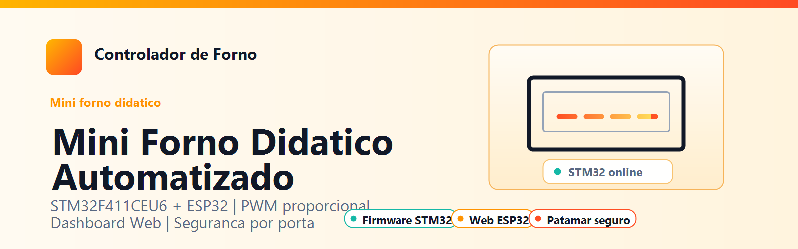
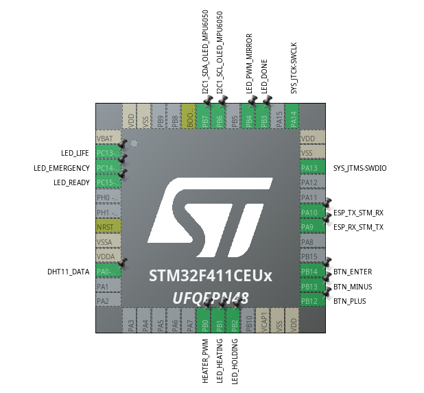
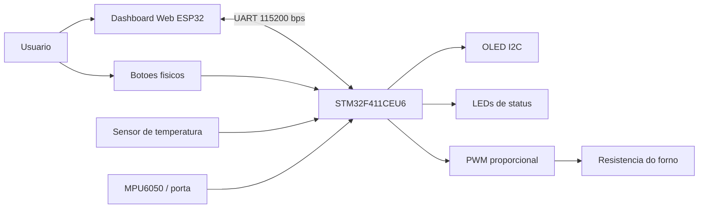
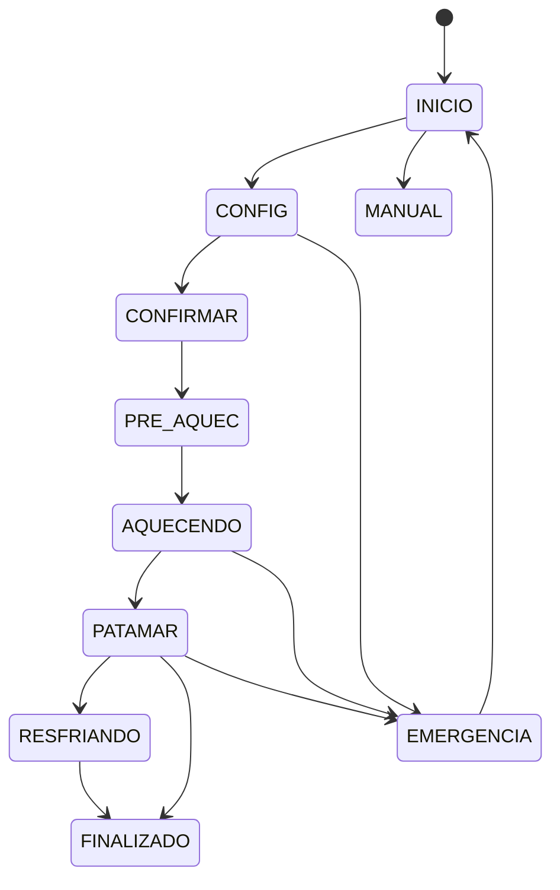
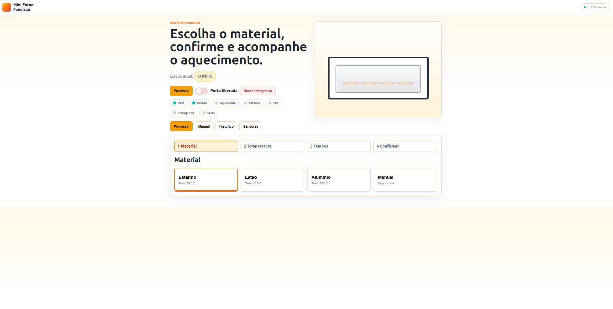
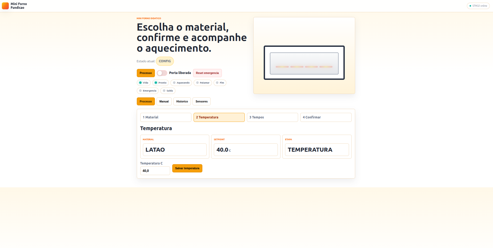
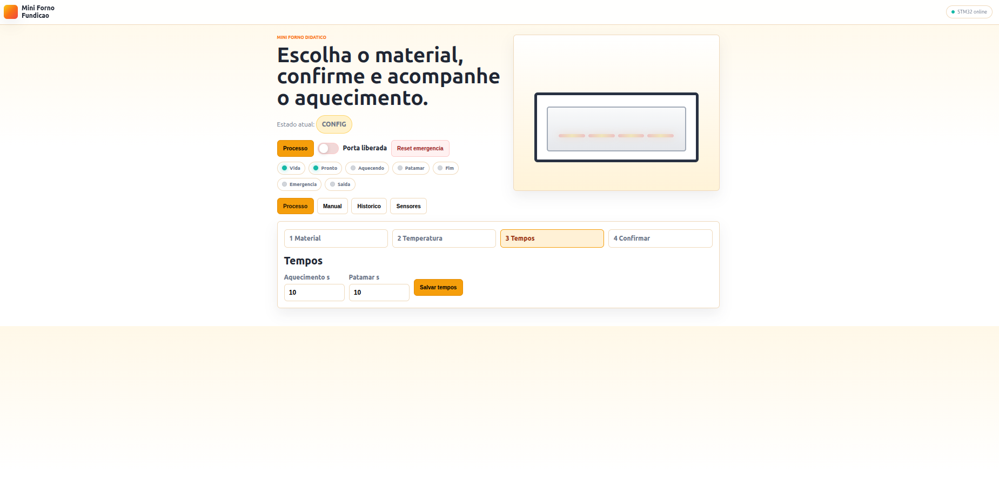
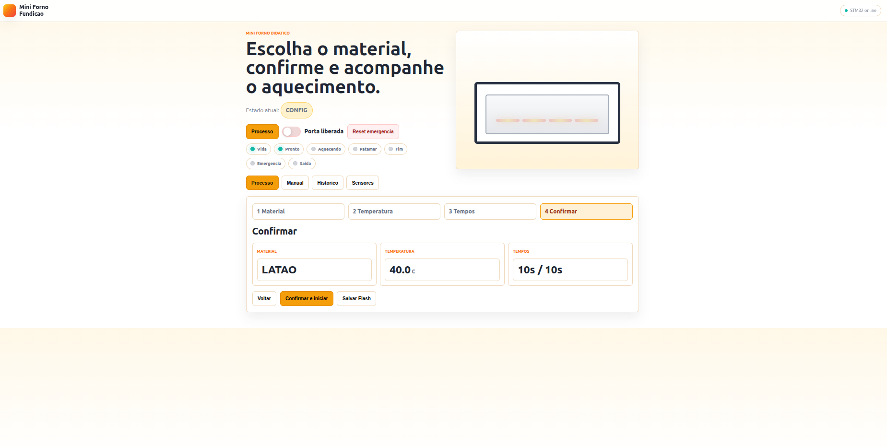
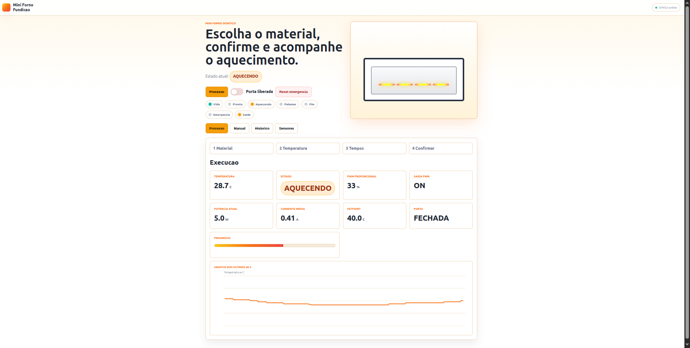
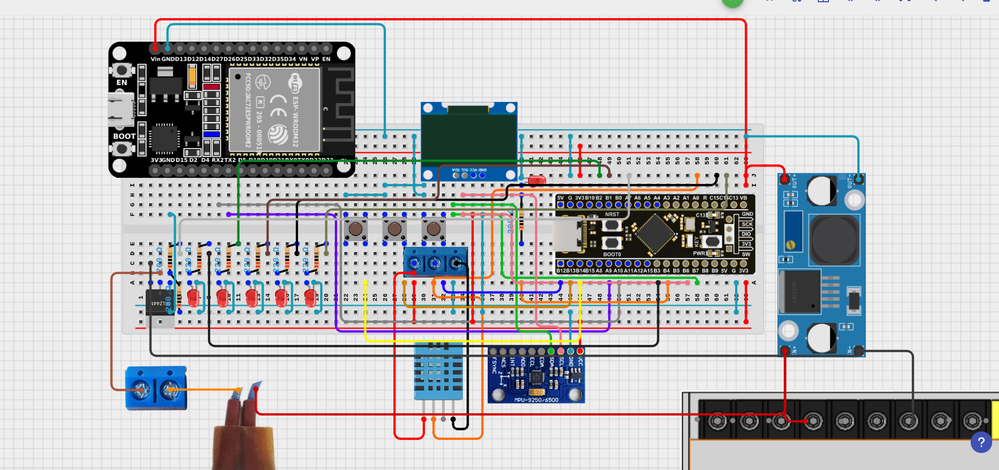

<p align="center">
  
</p>

<h1 align="center">Mini Forno Didatico Automatizado</h1>

<p align="center">
  <strong>Controle de aquecimento com STM32F411CEU6, ESP32, PWM proporcional, sensores e dashboard web.</strong>
</p>

<p align="center">
  
  
  
  
</p>

## Sumario

- [Visao geral](#visao-geral)
- [Objetivo academico](#objetivo-academico)
- [Estrutura do repositorio](#estrutura-do-repositorio)
- [Componentes](#componentes)
- [Mapa de pinos](#mapa-de-pinos)
- [Arquitetura do sistema](#arquitetura-do-sistema)
- [Logica de funcionamento](#logica-de-funcionamento)
- [Comunicacao STM32 e ESP32](#comunicacao-stm32-e-esp32)
- [Dashboard web](#dashboard-web)
- [Como abrir e gravar](#como-abrir-e-gravar)
- [Galeria](#galeria)
- [Participantes](#participantes)

## Visao geral

O **Mini Forno Didatico Automatizado** e um projeto academico de microcontroladores que simula o controle de um forno de pequeno porte. O sistema usa um STM32 como controlador principal do processo termico e um ESP32 como interface web para configuracao, monitoramento e comandos remotos.

A proposta e permitir que o usuario configure material, temperatura, tempo de aquecimento e tempo de patamar tanto pelos botoes fisicos quanto pela pagina web. Durante o processo, o firmware controla a resistencia por PWM proporcional, acompanha sensores, monitora a porta e envia telemetria para o dashboard.

## Objetivo academico

O projeto demonstra, em uma unica aplicacao, conceitos importantes de sistemas embarcados:

- leitura de sensores analogicos/digitais;
- controle PWM de potencia;
- maquina de estados;
- comunicacao serial entre microcontroladores;
- interface web embarcada;
- tratamento de seguranca por estado de porta;
- registro historico de operacao;
- integracao entre firmware STM32CubeIDE e Arduino/ESP32.

## Estrutura do repositorio

```text
MiniForno-Didatico-Automatizado/
|-- README.md
|-- .gitignore
|-- assets/
|   |-- banner.png
|   |-- circuito-completo.svg
|   |-- mapa-pinos-stm32f411.png
|   `-- screenshots/
|       |-- 01-material.png
|       |-- 02-temperatura.png
|       |-- 03-tempos.png
|       |-- 04-confirmacao.png
|       |-- 05-execucao.png
|       `-- 06-circuito.png
|-- docs/
|   |-- mapa-de-pinos.md
|   `-- protocolo-comunicacao.md
`-- firmware/
    |-- stm32/
    |   `-- DRIVERSTM32/
    |       |-- DRIVERSTM32.ioc
    |       |-- Inc/
    |       |-- Src/
    |       |-- Startup/
    |       `-- Drivers/
    `-- esp32/
        `-- ESP32_Web_MiniForno/
            `-- ESP32_Web_MiniForno.ino
```

> Os arquivos de firmware foram copiados sem alteracao de logica. A reorganizacao e somente de pastas, assets e documentacao para publicacao no GitHub.

> Observacao: alguns arquivos herdados do projeto STM32CubeIDE mantem nomes `STM32F401CEUX`. Eles foram preservados para nao alterar a programacao original. A documentacao visual do hardware usa `STM32F411CEU6`, conforme o pinout final enviado para o projeto.

## Componentes

| Componente | Funcao no projeto |
| --- | --- |
| STM32F411CEU6 | Controle principal do forno, estados, PWM, sensores e botoes |
| ESP32 | Servidor web, dashboard, comandos remotos e ponte serial |
| Sensor de temperatura DHT11/LM35 | Leitura da temperatura usada pelo controle |
| MPU6050 | Leitura de angulo para detectar condicao da porta |
| Display OLED I2C | Exibicao local de estado, temperatura e configuracoes |
| Botoes fisicos | Navegacao e ajuste de configuracoes sem a pagina web |
| LEDs de status | Indicacao de vida, pronto, aquecendo, patamar, fim, emergencia e PWM |
| Resistencia/aquecedor | Carga controlada pelo PWM proporcional |
| Fonte e modulo de potencia | Alimentacao e acionamento da carga |

## Mapa de pinos

O mapa abaixo foi consolidado a partir de `firmware/stm32/DRIVERSTM32/Inc/main.h` e da imagem de pinout enviada para o projeto.

| Pino STM32 | Nome no firmware | Funcao |
| --- | --- | --- |
| PA0 | `DHT11_Pin` / `LM35_Pin` | Sensor de temperatura |
| PB6 | `OLED_SCL_Pin` | Barramento I2C1 SCL para OLED/MPU6050 |
| PB7 | `OLED_SDA_Pin` | Barramento I2C1 SDA para OLED/MPU6050 |
| PA9 | `ESP_RX_Pin` no `.ioc` / USART1 TX | TX do STM32 para RX do ESP32 |
| PA10 | `ESP_TX_Pin` no `.ioc` / USART1 RX | RX do STM32 vindo do TX do ESP32 |
| PB0 | `HEATER_PWM_Pin` | PWM da resistencia pelo TIM3 |
| PB4 | `LED_PWM_MIRROR_Pin` | LED espelho do nivel de PWM |
| PC14 | `LED_EMERGENCY_Pin` | LED de emergencia |
| PC15 | `LED_READY_Pin` | LED de pronto |
| PB1 | `LED_HEATING_Pin` | LED de aquecimento |
| PB2 | `LED_HOLDING_Pin` | LED de patamar |
| PB3 | `LED_DONE_Pin` | LED de finalizacao |
| PB12 | `BTN_PLUS_Pin` | Botao de incremento |
| PB13 | `BTN_MINUS_Pin` | Botao de decremento |
| PB14 | `BTN_ENTER_Pin` | Botao de confirmacao |

<p align="center">
  
</p>

## Arquitetura do sistema



O STM32 concentra a logica critica do processo. O ESP32 nao substitui o controlador principal: ele atua como interface web, enviando comandos e exibindo os dados recebidos pela UART.

## Logica de funcionamento

O firmware do STM32 trabalha com uma maquina de estados. Cada estado representa uma etapa clara do processo:



### Aquecimento proporcional

Durante `PRE_AQUEC`, `AQUECENDO` e `PATAMAR`, a potencia da resistencia e calculada conforme o erro entre setpoint e temperatura atual. Se a temperatura ja atingiu ou passou o setpoint, o PWM vai para zero.

```c
static uint8_t Proportional_ComputeDuty(int32_t temp_x10)
{
  error = cfg.setpoint_x10 - temp_x10;
  if (error <= 0L)
  {
    return 0U;
  }

  output = (cfg.kp_x100 * error) / 1000L;
  output = ClampLong(output, 0L, 100L);
  return (uint8_t)output;
}
```

### Regra correta do patamar

O tempo de patamar so conta quando a temperatura esta no setpoint ou acima dele. Se a temperatura cair abaixo do setpoint, o temporizador e zerado e so volta a contar quando o forno recuperar a temperatura.

```c
if ((temp_x10 < 0L) || (temp_x10 < cfg.setpoint_x10))
{
  soak_start_ms = 0U;
  soak_timer_running = 0U;
  return;
}

if (soak_timer_running == 0U)
{
  soak_start_ms = now;
  soak_timer_running = 1U;
}
```

Essa regra evita que o forno finalize o processo apenas por tempo corrido. O patamar representa tempo util na temperatura desejada.

## Comunicacao STM32 e ESP32

A comunicacao e serial UART em 115200 bps. O ESP32 envia comandos textuais e o STM32 responde com telemetria, `ACK` ou `ERR`.

### Exemplos de comandos

| Comando | Funcao |
| --- | --- |
| `PROFILE=ESTANHO` | Seleciona perfil/material |
| `SET10,400` | Define setpoint em decimos de grau, exemplo 40.0 C |
| `HEATTIME=10` | Define tempo de aquecimento |
| `SOAK=10` | Define tempo de patamar |
| `CONFIRM` | Confirma configuracao e inicia |
| `STATE=INICIO` | Retorna ao inicio pelo botao web |
| `MANUAL=50` | Define PWM manual em 50% |
| `SAFETY,1` | Ativa seguranca da porta |
| `CAL` | Calibra MPU6050 |
| `GET` | Solicita atualizacao de dados |

No ESP32, o envio centralizado passa por `sendCommand`:

```cpp
void sendCommand(const String &cmd) {
  pendingCommand = true;
  lastCommandSent = cmd;
  lastCommandMs = millis();
  STMSerial.print(cmd);
  STMSerial.print("\r\n");
  STMSerial.flush();
}
```

No STM32, os comandos sao interpretados em `Command_Process`:

```c
static uint8_t Command_Process(const char *cmd)
{
  command_error_reason = "UNKNOWN_COMMAND";

  if (strcmp(cmd, "GET") == 0)
  {
    /* Force telemetry only. */
  }
  else if (strcmp(cmd, "START") == 0)
  {
    Oven_Start();
  }
}
```

A telemetria e enviada como uma linha `DATA,...` contendo temperatura, setpoint, estado, porta, PWM, perfil, etapa, LEDs e revisoes de sincronizacao.

```c
snprintf(tx, sizeof(tx),
  "DATA,TEMP10=%ld,SP10=%ld,HEATER=%u,POWER=%u,STATE=%s,...",
  oven_data.temperature_x10,
  oven_data.setpoint_x10,
  (unsigned int)oven_data.heater_relay_on,
  (unsigned int)oven_data.heater_output_percent,
  Oven_StateName(oven_data.current_state));
```

## Dashboard web

O ESP32 hospeda uma pagina de controle com as seguintes rotas:

| Rota | Metodo | Uso |
| --- | --- | --- |
| `/` | GET | Interface principal |
| `/api/data` | GET | Estado atual em JSON |
| `/api/cmd` | GET/POST | Envio de comandos ao STM32 |
| `/api/export` | GET | Historico em CSV |

Na pagina, as alteracoes de perfil, temperatura, tempos, seguranca, modo manual e retorno ao inicio sao enviadas pela API:

```js
function sendMany(list) {
  return fetch('/api/cmd', {
    method: 'POST',
    headers: {'Content-Type': 'text/plain'},
    body: list.join('|'),
    cache: 'no-store'
  });
}
```

A atualizacao visual usa leituras periodicas de `/api/data`:

```js
function refresh() {
  fetch('/api/data', {cache:'no-store'})
    .then(r => r.json())
    .then(d => {
      updateState(d);
      updateCards(d);
      renderStage(d);
    });
}
```

O historico e exportado por `/api/export` e registra temperatura, porta e PWM durante as etapas de pre-aquecimento e aquecimento.

## Como abrir e gravar

### STM32CubeIDE

1. Abra o STM32CubeIDE.
2. Selecione `File > Import > Existing Projects into Workspace`.
3. Aponte para `firmware/stm32/DRIVERSTM32`.
4. Abra `DRIVERSTM32.ioc` para visualizar a configuracao do MCU.
5. Compile e grave na placa usando ST-Link.

> Caso o CubeIDE mostre nomes herdados de `STM32F401CEUX` nos scripts de linker, mantenha como esta neste repositorio se o objetivo for preservar exatamente a programacao atual.

### Arduino IDE / ESP32

1. Abra `firmware/esp32/ESP32_Web_MiniForno/ESP32_Web_MiniForno.ino`.
2. Selecione a placa ESP32 correspondente.
3. Configure a porta serial correta.
4. Grave o sketch no ESP32.
5. Acesse a pagina web exibida pelo ESP32 para controlar o forno.

## Galeria

### Fluxo de configuracao

| Material | Temperatura | Tempos |
| --- | --- | --- |
|  |  |  |

| Confirmacao | Execucao |
| --- | --- |
|  |  |

### Circuito

<p align="center">
  
</p>

O arquivo vetorial completo tambem esta disponivel em [`assets/circuito-completo.svg`](assets/circuito-completo.svg).

## Participantes

| Campo | Informacao |
| --- | --- |
| Aluno(s) | Diogo Hantke Rodrigues Garcia, Leticia Polatto de Novaes |
| Orientador(a) | Marcos Aparecido Chaves Ferreira  |
| Instituicao | IFSP - Instituto Federal de Educação, Ciência e Tecnologia de São Paulo  |
| Disciplina | SISTEMAS MICROCONTROLADOS |

## Referencia visual

A organizacao deste README foi inspirada no estilo de documentacao do repositorio [DiogoHantke/Simon-memory-game-ATMEGA328p](https://github.com/DiogoHantke/Simon-memory-game-ATMEGA328p), adaptada para o contexto do Mini Forno Didatico.
