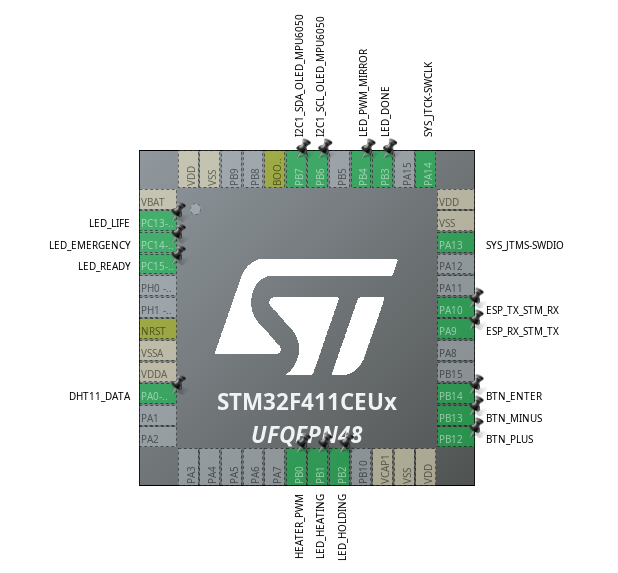

# Mapa de pinos

Este documento resume os pinos usados pelo firmware STM32. A fonte principal e `firmware/stm32/DRIVERSTM32/Inc/main.h`.

Alguns arquivos do projeto CubeIDE preservam nomes `STM32F401CEUX` por heranca do projeto original. A imagem e esta documentacao usam `STM32F411CEU6`, conforme o pinout final do projeto.

| Pino | Sinal | Direcao | Observacao |
| --- | --- | --- | --- |
| PA0 | `DHT11_Pin` / `LM35_Pin` | Entrada | Sensor de temperatura |
| PB6 | `OLED_SCL_Pin` | I2C | SCL compartilhado por OLED/MPU6050 |
| PB7 | `OLED_SDA_Pin` | I2C | SDA compartilhado por OLED/MPU6050 |
| PA9 | USART1 TX | Saida | STM32 envia dados para ESP32 |
| PA10 | USART1 RX | Entrada | STM32 recebe comandos do ESP32 |
| PB0 | `HEATER_PWM_Pin` | Saida PWM | Controle da resistencia |
| PB4 | `LED_PWM_MIRROR_Pin` | Saida PWM | Espelho visual do PWM |
| PC14 | `LED_EMERGENCY_Pin` | Saida | Indicacao de emergencia |
| PC15 | `LED_READY_Pin` | Saida | Indicacao de pronto |
| PB1 | `LED_HEATING_Pin` | Saida | Indicacao de aquecimento |
| PB2 | `LED_HOLDING_Pin` | Saida | Indicacao de patamar |
| PB3 | `LED_DONE_Pin` | Saida | Indicacao de fim |
| PB12 | `BTN_PLUS_Pin` | Entrada pull-up | Incremento |
| PB13 | `BTN_MINUS_Pin` | Entrada pull-up | Decremento |
| PB14 | `BTN_ENTER_Pin` | Entrada pull-up | Confirmacao |

